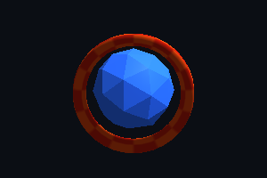
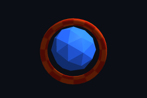
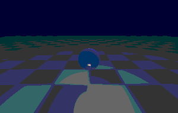

# 3d-x-2

The **enhanced** edition of [3d-x](../3d-x) — a complete, dependency-free **3D
graphics library for Go**. Build and render 3D content and animation entirely in
software, with a faster rasterizer, real anti-aliasing, fog, wireframe,
billboards and a particle system — all behind a clean sub-package layout and a
single-import façade.

No GPU. No cgo. No third-party modules — standard library only.

> Made with [CREADDINSCART STUDIO](https://www.shit.pub/studio/)
> Author: **CREADDINSCART STUDIO · Btoom KtCher (BKC)**

| 1 sample (no AA) | 4 samples (16× AA) |
|---|---|
|  |  |



---

## What's new over 3d-x

- **Faster rasterizer** — incremental edge-function triangle fill (adds instead
  of recomputing barycentrics per pixel). ~7 % faster than 3d-x on the same
  sphere benchmark, while doing strictly more.
- **Supersampling anti-aliasing** — `Renderer.WithAA(2)` (4×) or `WithAA(4)`
  (16×), resolved by box-filtering. See the table above.
- **Depth fog** — linear / exponential / exp² fog on the `Scene`, blended per
  fragment by view distance.
- **Wireframe mode** — `Renderer.Wireframe = true` draws clipped triangle edges.
- **Billboards & particles** — camera-facing sprites with depth test and alpha
  or additive blending, plus an out-of-the-box `ParticleSystem` (gravity,
  spread, fade-out, glow texture).
- **Clearer structure** — split into focused packages with a façade that
  re-exports the common surface.

Everything from 3d-x is still here: `Vec2/3/4`, `Mat4`, `Quaternion`, parametric
meshes, OBJ import/export, procedural + image textures, ambient/directional/
point/spot lights, Blinn-Phong shading (flat/Gouraud/Phong), scene graph,
keyframe animation, fixed-timestep loop, PNG/GIF and ANSI truecolor output.

---

## Package layout

```
creaddinscart.studio.go.sl/3d-x-2
├── x3d.go          façade: aliases + convenience (single import)
├── math32/         Vec2/3/4 · Mat4 · Quaternion · Color · scalars
├── geometry/       Mesh · primitives · OBJ in/out
├── texture/        bilinear Texture · procedural (checker/noise/brick/…)
├── scene/          Node · Entity · Scene · Light · Material · Camera · Fog
├── render/         Framebuffer · fast rasterizer · AA · wireframe · billboards · PNG/GIF/ANSI
├── anim/           easing · Tween · keyframes · Clip · Animator · GameLoop · ParticleSystem
└── examples/       cube · aa · particles
```

The façade re-exports the common API, so most programs only need:

```go
import x3d "creaddinscart.studio.go.sl/3d-x-2"
```

Power users can import sub-packages directly (e.g. `.../math32`) — the façade
types are Go type aliases, so they are interchangeable.

---

## Install

```bash
go get creaddinscart.studio.go.sl/3d-x-2
# if the custom host isn't in your proxy:
GOPROXY=direct go get creaddinscart.studio.go.sl/3d-x-2
```

Or `replace creaddinscart.studio.go.sl/3d-x-2 => ./3d-x-2` to vendor this folder.
Requires **Go 1.21+**.

---

## Quick start

```go
fb  := x3d.NewFramebuffer(320, 200)
cam := x3d.NewCamera(x3d.V3(0, 1.4, 4), x3d.Zero3, 1.6)

sc := x3d.NewScene()
sc.AddMesh("cube", x3d.Cube(1.6),
    x3d.NewMaterial(x3d.Hex("#e8e8e8")).Textured(x3d.TexChecker(8, 8, x3d.Hex("#2b6cff"), x3d.White)))

x3d.NewRenderer(fb, cam).WithAA(4).Render(sc)  // 16× anti-aliased
fb.SavePNG("cube.png")                          // or fb.Print() for ANSI art
```

### Fog + particles

```go
sc.Fog = x3d.Fog{Mode: x3d.FogExp, Color: x3d.Hex("#101826"), Density: 0.055}

ps := x3d.NewParticles(x3d.ParticleConfig{
    Origin: x3d.V3(0, 0.2, 0), Direction: x3d.V3(0, 1, 0), Speed: 4.2,
    Spread: x3d.V3(1.1, 0.6, 1.1), Rate: 140, Lifetime: 1.8,
    Size: 0.22, Color: x3d.Hex("#ffcf6b"), Gravity: 5.5,
    FadeOut: true, Additive: true, Max: 1200,
})
// each frame:
ps.Update(dt)
sc.Points = ps.AppendPoints(sc.Points[:0])
x3d.NewRenderer(fb, cam).WithAA(2).Render(sc)
```

### Animation

```go
clip := x3d.NewClip("bob")
clip.AddPosition("cube", []x3d.Keyframe{
    {Time: 0, Value: x3d.V3(0, 0, 0)},
    {Time: 1, Value: x3d.V3(0, 2, 0), Ease: x3d.EaseOutBounce},
})
an := x3d.NewAnimator(clip, sc); an.Loop = true
x3d.NewGameLoop(60).Run(func(dt float32) { an.Advance(dt) },
    func() bool { x3d.NewRenderer(fb, cam).Render(sc); fb.Print(); return true })
```

---

## Examples

| Command | Shows |
|---|---|
| `go run ./examples/cube -aa 4`      | Textured lit cube, 16× AA → PNG + ANSI frame |
| `go run ./examples/aa`              | AA off vs on, side-by-side PNGs |
| `go run ./examples/particles`       | Particle fountain over a fogged checkered floor → GIF |

```bash
go test ./...                       # 14 tests
go test -run '^$' -bench . ./...    # benchmarks
```

Prebuilt example binaries for macOS / Linux / Windows (arm64 + amd64) are in
[`dist/`](dist/).

---

## License

[MIT](LICENSE) © 2026 **CREADDINSCART STUDIO**.

Carries the CREADDINSCART STUDIO **Four Conditions of Use** (author attribution,
a visible "Made with CREADDINSCART STUDIO" line, a working link to
<https://www.shit.pub/studio/>, and source credit for reused code). See
[`LICENSE`](LICENSE).

**Made with [CREADDINSCART STUDIO](https://www.shit.pub/studio/)**
